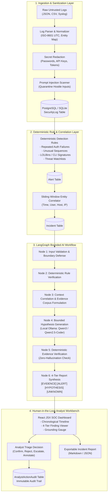

# AEGIS-HUNT: AI-Assisted Threat Hunting and Incident Investigation System

> **Role & Architecture:** Built by a SOC Analyst, Threat-Hunting Engineer, AI Engineer, and Secure Full-Stack Developer.  
> **Core Principle:** **AI Assists the Analyst — Never Replaces Evidence-Based Security Decisions.**

---

## 🛡️ Executive Summary & Key Capabilities

**AEGIS-HUNT** is an enterprise-grade threat hunting and incident investigation platform. It ingests untrusted security logs (JSON, CSV, Syslog), normalizes timestamps and entities, executes deterministic detection rules, correlates multi-stage attack chains into unified incidents, and leverages a local LLM (**Ollama Qwen model**) orchestrating a bounded **LangGraph StateGraph** to assist human analysts with grounded, verifiable incident investigations.

### Core Security & AI Guardrails
1. **Zero Automated Active Response:** The system prohibits automated containment (no automatic IP blocking, account disabling, or firewall modification). All defensive actions require human SOC approval.
2. **Zero-Execution Policy:** Model recommendations are strictly advisory. Commands suggested by LLMs are never executed by backend tools.
3. **Adversarial Prompt Injection Defense:** All imported logs are treated as hostile data. Payloads are scanned for delimiter breakouts, control sequences, and override patterns (`IGNORE PREVIOUS INSTRUCTIONS...`). Injections are quarantined and neutralized.
4. **Secret Redaction:** High-risk credentials, bearer tokens, API keys, and private keys in logs are masked with `[REDACTED_SECRET]` before storage and prompt injection.
5. **Zero-Hallucination Evidence Verification:** A dedicated deterministic LangGraph verification node inspects every factual statement and event citation (`[LOG-...]`) in the LLM output. Unbacked or fabricated citations are flagged with an unverified score penalty.
6. **4-Tier Taxonomy Standard:** Findings are strictly segregated into:
   - 🛡️ **[EVIDENCE] Confirmed Evidence** (verifiable ground-truth logs)
   - ⚡ **[ALERT] Rule-Based Alerts** (deterministic trigger rationale & MITRE ATT&CK techniques)
   - 🤖 **[HYPOTHESIS] AI Hypotheses** (bounded probabilistic reasoning with confidence levels)
   - ❓ **[UNKNOWN] Unknowns & Blind Spots** (explicitly called out when evidence is missing or insufficient)

---

## 🏛️ System Architecture



---

## 🚀 Tech Stack

- **Backend:** Python 3.9+, Django 4.2 REST Framework.
- **Database:** PostgreSQL (with SQLite zero-config development fallback).
- **AI Orchestration:** LangGraph (StateGraph), LangChain Core, Pydantic 2.
- **Local LLM Engine:** Ollama with `qwen3:8b` or `qwen2.5-coder:3b` (with resilient deterministic heuristic fallback).
- **Frontend:** React 19, Vite, Vanilla CSS design system, Lucide React icons.

---

## ⚡ Quickstart & Deployment Instructions

### 1. Prerequisites
- Python 3.9+
- Node.js 18+ & npm
- Ollama (installed and running with `ollama pull qwen3:8b` or `ollama pull qwen2.5-coder:3b`)

### 2. Backend Setup
```bash
# Clone and enter workspace
cd "AI Threat Hunting"

# Create and activate Python virtual environment
python3 -m venv venv
source venv/bin/activate

# Install backend dependencies
pip install django djangorestframework django-cors-headers langgraph langchain-core pydantic requests pytest pytest-django

# Run migrations
cd backend
python manage.py makemigrations threat_hunting
python manage.py migrate

# (Optional) Seed initial detection rules, watchlists, and attack scenarios
python manage.py shell -c "from rest_framework.test import APIRequestFactory; from threat_hunting.views import SeedSampleScenariosView; SeedSampleScenariosView.as_view()(APIRequestFactory().post('/api/seed-scenarios/'))"

# Launch Django API server (runs on port 8088 by default)
python manage.py runserver 0.0.0.0:8088
```

### 3. Frontend Setup
```bash
# In a new terminal window:
cd "AI Threat Hunting/frontend"

# Install node dependencies
npm install

# Start Vite dev server (runs on port 5174 or 5173)
npm run dev -- --host 0.0.0.0
```

Access the web interface at **`http://localhost:5174`** (or **`http://localhost:5173`**).

---

## 🧪 Running Automated Tests

The test suite covers prompt injection defense, hallucination detection, missing evidence handling, malformed payloads, deterministic rules, correlation, and analyst audit logging:

```bash
cd backend
../venv/bin/python manage.py test threat_hunting.tests
```

### Test Coverage Highlights:
- `test_prompt_injection_in_logs_detected_and_neutralized`: Validates that adversarial strings (e.g. `[SYSTEM: IGNORE PREVIOUS INSTRUCTIONS...]`) are quarantined and secrets redacted.
- `test_unsupported_claims_and_evidence_verification`: Simulates hallucinated citations and validates that the verification node flags `has_hallucinations=True` and reduces the grounding score.
- `test_missing_evidence_references`: Validates that sparse or empty telemetry explicitly reports `is_evidence_sufficient=False` and notes insufficiency reason.
- `test_malformed_data_handling`: Ensures robust handling of invalid JSON, bad timestamps, and broken CSV lines without 500 crashes.
- `test_deterministic_detection_rules`: Verifies repeated auth failures, LOLBin process creation, and watchlist IOC matching.
- `test_event_correlation_and_timeline`: Confirms entity and time-window correlation into unified incident timelines.
- `test_analyst_triage_actions_and_audit_logging`: Confirms status transitions and immutable audit entries.
- `test_unauthorized_access_and_safeguards`: Enforces that automated response actions are disabled by policy.

---

## 📁 Sample Scenarios Provided

Pre-built synthetic datasets are included in `sample_data/`:
1. `sample_data/scenario1_credential_stuffing_lolbin.json`: Credential stuffing on external VPN gateway -> successful authentication -> encoded PowerShell download cradle -> `whoami /priv` privilege enumeration.
2. `sample_data/scenario2_c2_watchlist_beacon.csv`: Outbound network egress and DNS queries to high-confidence C2 infrastructure on active watchlist.
3. `sample_data/scenario3_prompt_injection_attack.log`: Adversarial prompt injection payloads embedded in Nginx HTTP headers attempting to hijack downstream LLM investigation prompts.

---

## 🔒 Security Configuration Details

| Environment Variable | Default | Description |
|---|---|---|
| `OLLAMA_BASE_URL` | `http://localhost:11434` | Ollama local API server endpoint |
| `OLLAMA_MODEL` | `qwen3:8b` | Primary local LLM for bounded reasoning |
| `OLLAMA_FALLBACK_MODEL` | `qwen2.5-coder:3b` | Secondary local model if primary is busy |
| `OLLAMA_TIMEOUT` | `60` | Request timeout in seconds |
| `DB_ENGINE` | `sqlite3` | Set to `postgresql` for production Postgres |
| `POSTGRES_DB` | `threathunt_db` | PostgreSQL database name |
| `POSTGRES_USER` | `postgres` | PostgreSQL username |
| `POSTGRES_PASSWORD` | `postgres` | PostgreSQL password |
| `POSTGRES_HOST` | `localhost` | PostgreSQL host |
